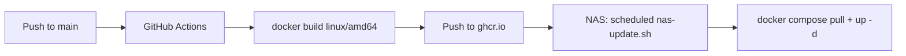

# Renne Telegram Bot

A TypeScript Telegram bot with torrent downloads, media conversion, and image search.

## Features

| Feature | Description |
|---------|-------------|
| 📥 Torrent | Download from magnet link or .torrent file, auto-upload to Telegram |
| 🖼 Image | Convert to GIF, Google Lens search, Yandere reverse search |
| 🎬 Video | Convert to GIF |
| 🎞 GIF | Convert to video or extract frame |
| 🔗 URL Fixer | Auto-fix x.com → fixupx.com; Facebook video/photo download (facebed fallback) |
| 📦 Smart ZIP | Compress >2GB folders automatically |

## Setup

```bash
# Install dependencies
npm install

# Install ffmpeg (required for video conversion)
# macOS
brew install ffmpeg
# Ubuntu
sudo apt install ffmpeg

# Configure
cp .env.example .env
# Edit .env with your bot token

# Run
npm run dev
```

## Commands

- `/start` — Brief info
- `/help` — Full command list
- `/bt` — Start torrent download
- Send `.torrent` or magnet link directly

## Architecture

```
src/
├── bot.ts              # Entry point
├── commands/           # Bot commands
│   ├── start.ts
│   ├── help.ts
│   └── bt.ts
├── handlers/           # Content handlers
│   ├── image.ts
│   ├── video.ts
│   ├── gif.ts
│   ├── torrent.ts
│   └── url.ts
├── modules/            # Core logic
│   ├── torrent.ts      # WebTorrent download
│   ├── media.ts        # Image/video conversion
│   ├── search.ts       # Image search
│   └── zipper.ts       # ZIP compression
└── utils/              # Helpers
    ├── constants.ts
    ├── progress.ts     # Progress message updates
    └── tg.ts           # Telegram utilities
```

## Torrent Download Flow

1. User sends torrent/magnet → bot crawls file info
2. If single file ≤ 2GB → download & upload directly
3. If images → download & send (compressed + uncompressed)
4. If >2GB folder → download & ZIP, then send ZIP
5. Progress message updates in real-time

## Requirements

- Node.js ≥ 18
- ffmpeg (for video/gif conversion)
- Telegram Bot Token

## Production Deployment (Docker)

The bot ships as a Docker image on **GitHub Container Registry (GHCR)**.
Every push to `main` builds and publishes `ghcr.io/lenchan139/renne-tgbot:latest`
(plus `sha-<short>` and branch tags). The image is `linux/amd64`, matching
Intel/AMD Synology NAS models.



### 1. Make the GHCR package visible (one-time)

The workflow uses the built-in `GITHUB_TOKEN` with `packages: write`, so no
extra secrets are needed. By default the package is **private** — either:

- Keep it private and log in on the NAS first:
  ```bash
  echo <YOUR_GITHUB_PAT> | docker login ghcr.io -u lenchan139 --password-stdin
  ```
  (PAT needs the `read:packages` scope.)
- Or, in GitHub → **Packages → renne-tgbot → Package settings**, change the
  visibility to **Public** so the NAS can pull without credentials.

### 2. Deploy on the Synology NAS

Create the project directory and copy the compose files
(`docker-compose.yml`, `.env`, `scripts/nas-update.sh`) to the NAS, e.g.
`/volume1/docker/renne-tgbot`, then:

```bash
cd /volume1/docker/renne-tgbot

# Create .env with your token
cp .env.example .env   # or create it manually
vi .env                # BOT_TOKEN=..., TELEGRAPH_TOKEN=...

docker compose pull
docker compose up -d
docker compose logs -f
```

> The bot reads `BOT_TOKEN` / `TELEGRAPH_TOKEN` from the environment
> (`env_file: .env`). No secrets are baked into the image.

### 3. Automatic updates (Task Scheduler)

`scripts/nas-update.sh` pulls the latest image and recreates the container
without touching your `.env` or the temp volume.

In DSM: **Control Panel → Task Scheduler → Create → Scheduled Task**, with:

| Field | Value |
|-------|-------|
| User | `root` (required for docker) |
| Schedule | Every 30 minutes (or hourly) |
| Command | `/volume1/docker/renne-tgbot/scripts/nas-update.sh` |

The script's output is appended to `/volume1/docker/renne-tgbot/update.log`.

### Useful commands

```bash
docker compose ps                 # container status
docker compose logs -f            # live logs
docker compose pull && docker compose up -d   # manual update
docker compose down               # stop & remove container
```

### Image tags

| Tag | Built when |
|-----|-----------|
| `latest` | push to `main` |
| `main` | push to `main` |
| `sha-<short>` | every build (pinned commit) |
| `1.2.3` / `1.2` | push a `v1.2.3` git tag |

> **Note:** the previous pm2 / `_pm2_prod_run` deployment flow has been removed
> in favour of Docker. Legacy helpers (`ecosystem/`, `scripts/prod-start.sh`,
> `scripts/update-checker.cjs`) are kept only for reference and are no longer
> wired to CI.

